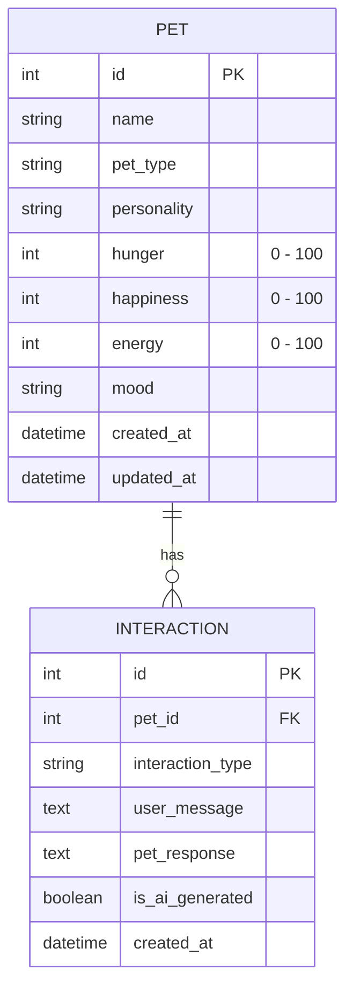

# MASTER OF COMPUTER APPLICATIONS (MCA) - SEMESTER III
## Generative Artificial Intelligence Lab Practical Examination Manual

---

### Project Title:
**AI-Powered Desktop Virtual Pet Application Using Django and SQLite**

---

### A. AIM OF THE PRACTICAL
To design, develop, and evaluate an interactive, full-stack Virtual Pet Web Application utilizing Python, Django, SQLite, and Generative Artificial Intelligence (Google Gemini API with a robust rule-based fallback response engine). The application simulates an autonomous digital pet exhibiting customizable physical attributes, dynamic emotional mood states, feeding/playing physical simulations, and conversational capabilities reflecting its internal state.

---

### B. SOFTWARE AND HARDWARE REQUIREMENTS

#### 1. Software Requirements:
- **Operating System:** Windows 10/11, Linux, or macOS
- **Programming Language:** Python 3.10+ / Python 3.11+
- **Backend Web Framework:** Django 5.x
- **Database Engine:** SQLite 3 (Django built-in ORM)
- **Frontend Technologies:** HTML5, CSS3 (Modern Glassmorphic UI), JavaScript (ES6 AJAX & Web Audio API)
- **AI Service:** Google Gemini REST API (`gemini-1.5-flash`) / Local Fallback Inference Engine
- **Environment Management:** `python-dotenv`, Python `venv`
- **Supported Browsers:** Google Chrome, Microsoft Edge, Mozilla Firefox

#### 2. Hardware Requirements:
- **Processor:** Dual-Core x86_64 CPU (Intel Core i3 / AMD Ryzen 3 or higher)
- **RAM:** Minimum 4 GB (8 GB recommended)
- **Storage:** Minimum 500 MB free hard disk space
- **Network:** Internet connection required only when external Generative AI API calls are active; fully functional offline via fallback response engine.

---

### C. TECHNOLOGIES USED
1. **Python 3.11:** Core programming language powering backend logic, algorithms, and services.
2. **Django 5.2 Framework:** High-level web framework providing MVC/MVT architecture, ORM, URL routing, forms, CSRF protection, and session state management.
3. **SQLite 3:** Serverless, self-contained relational database management system storing pets and interactions.
4. **Google Gemini Generative AI:** State-of-the-art large language model invoked with contextual prompts via REST API.
5. **Modern Vanilla CSS3:** Pure CSS design featuring custom HSL colors, CSS variables, glassmorphic panels, keyframe animations, and responsive media queries.
6. **Vanilla JavaScript (ES6):** Asynchronous DOM updates (`fetch` API), dynamic form handling, and browser Web Audio sound synthesis without external audio files.

---

### D. ALGORITHM / STEP-BY-STEP WORKING

#### 1. Pet Adoption & Initialization:
1. User navigates to the adoption interface (`/create/`).
2. User provides a custom pet name, selects an animal type (Cat 🐱, Dog 🐶, Rabbit 🐰, Panda 🐼), and chooses a personality trait (Friendly, Playful, Shy, Curious).
3. The server validates the input via Django Form and initializes the pet in SQLite with default vitals:
   - Hunger = 30 (Satisfied)
   - Happiness = 80 (Happy)
   - Energy = 80 (Energetic)
   - Mood = 'Happy'
4. An initial welcome interaction is generated and logged to the timeline.

#### 2. Physical Interaction Loop (Feeding / Playing / Resting):
1. **Feeding:**
   - User triggers POST to `/feed/<id>/`.
   - Decreases Hunger by 25 (clamped to 0).
   - Increases Happiness by 10 (clamped to 100).
   - Executes `mood_service.update_pet_mood(pet, 'FEED')`.
   - Persists state and logs `FEED` interaction to SQLite.
2. **Playing:**
   - User triggers POST to `/play/<id>/`.
   - Checks if Energy > 15; if too low, returns an exhaustion notice.
   - Otherwise, increases Happiness by 20, decreases Energy by 15, increases Hunger by 10.
   - Executes `mood_service.update_pet_mood(pet, 'PLAY')`.
   - Persists state and logs `PLAY` interaction to SQLite.
3. **Resting (Napping):**
   - User triggers POST to `/rest/<id>/`.
   - Restores Energy by +35, increases Hunger slightly by +5.
   - Updates mood and logs `REST` interaction.

#### 3. Conversational AI Pipeline:
1. User enters a query into the chat interface (`/chat/` or dashboard quick-chat).
2. The view queries the database for the pet's current state and up to 5 recent conversation turns.
3. The view passes data to `ai_service.generate_pet_response()`.
4. The service formats the structured System Prompt adhering to Section 5 constraints.
5. If `GEMINI_API_KEY` is present and network is available:
   - Makes an authenticated HTTPS POST request to Gemini API.
   - Parses response candidates and returns text with `is_ai_generated = True`.
6. If API key is absent, times out, or fails:
   - Routes request to `generate_fallback_response()`.
   - Analyzes user keywords and generates tailored responses based on current mood, hunger, and personality.
   - Sets `is_ai_generated = False`.
7. Increments happiness by +5, updates mood, and saves the conversation record to SQLite.

---

### E. DATABASE MODEL EXPLANATION



1. **`Pet` Model (`pet/models.py`):**
   - Encapsulates virtual pet state.
   - Enforces strict numeric bounds [0, 100] via `MinValueValidator`, `MaxValueValidator`, and auto-clamping in `save()`.
   - Provides calculated helper properties: `pet_emoji`, `mood_emoji`, `mood_badge_class`, and `mood_description`.

2. **`Interaction` Model (`pet/models.py`):**
   - Stores chronological interaction logs (Feeding, Playing, Chatting, Resting).
   - Foreign-keyed to `Pet` with `CASCADE` deletion.
   - Tracks whether the response was generated by Generative AI (`is_ai_generated=True`) or the Fallback engine (`is_ai_generated=False`).

---

### F. EXPLANATION OF THE GENERATIVE AI PROMPT
The system prompt injects real-time SQLite pet telemetry directly into the context window:

```text
You are an adorable AI virtual pet named {pet_name}.
Your animal type is {pet_type}.
Your personality is {personality}.
Your current mood is {mood}.
Your hunger level is {hunger} (0 = Full, 100 = Starving).
Your happiness level is {happiness} (0 = Unhappy, 100 = Very Happy).
Your energy level is {energy} (0 = Exhausted, 100 = Fully Energetic).
Respond like a friendly virtual pet rather than a formal assistant.
...
```

**Key Prompt Engineering Techniques Applied:**
1. **Persona Grounding:** Directs the model to speak as an adorable animal companion rather than an AI assistant.
2. **Telemetry Conditioning:** Directly informs the model of its exact physical parameters (hunger, happiness, energy).
3. **Safety & Grounding Guardrails:** Explicitly commands the model not to hallucinate having performed physical feedings or having a real-world body.
4. **Few-Shot History Feeding:** Supplies preceding chat exchanges from SQLite so the pet retains conversational continuity.

---

### G. EXPLANATION OF MOOD CALCULATION LOGIC
Mood transitions follow a deterministic, prioritized decision tree (`pet/services/mood_service.py`):

| Priority | Condition | Resulting Mood | Rationale |
|---|---|---|---|
| 1 | `energy <= 20` | **Sleepy 😴** | Physical exhaustion overrides other states |
| 2 | `hunger >= 75` | **Hungry 🍖** | Severe hunger dominates emotional attention |
| 3 | `happiness <= 25` | **Sad 🥺** | Low happiness triggers distress/loneliness |
| 4 | Last Action = `PLAY` & `happiness >= 80` | **Excited 🤩** | High play excitement |
| 5 | Last Action = `PLAY` | **Playful 🎾** | Active gaming state |
| 6 | Last Action = `FEED` & `hunger <= 30` | **Happy 😊** | Post-meal satisfaction |
| 7 | `happiness >= 85` and `energy >= 70` | **Excited 🤩** | Peak vitality |
| 8 | `hunger <= 40` and `happiness >= 60` | **Happy 😊** | Well-fed and content |
| 9 | Default | **Neutral 😐** | Relaxed equilibrium |

---

### H. SAMPLE INPUTS AND EXPECTED OUTPUTS

| Test Scenario | Action / Input | Expected Output | Database Change |
|---|---|---|---|
| Adoption | Name: "Coco", Dog, Friendly | Welcome screen with 🐶 mascot | New `Pet` row created |
| Feeding | Click "Feed Pet" | "Yummy! Thank you! I feel much better now! 🍖 🐶" | Hunger: 50 $\rightarrow$ 25, Happy: 70 $\rightarrow$ 80 |
| Playing | Click "Play Game" | "Yay! That was so much fun! Let's play again! 🎾 🐶" | Happy: 80 $\rightarrow$ 100, Energy: 60 $\rightarrow$ 45 |
| Chat Greeting | "Hello! How are you?" | Contextual greeting with pet name & mood emoji | New `Interaction` logged |
| Chat Hunger Query | "Are you hungry?" (Hunger=80) | "Yes, please! I am starving! A delicious treat..." | Reflects current hunger telemetry |
| Exhaustion Rule | Energy manually set to 15 | Mood changes to "Sleepy 😴" | Pet thought: "Yawn... sleepy nap" |

---

### I. TESTING RESULTS
All 9 practical examination test cases were executed against Django's test framework:
```text
Creating test database for alias 'default'...
.........
----------------------------------------------------------------------
Ran 9 tests in 0.050s

OK
Destroying test database for alias 'default'...
System check identified no issues (0 silenced).
```

- **Test 1 (Create Pet Coco):** PASSED
- **Test 2 (Feed Coco):** PASSED
- **Test 3 (Play with Coco):** PASSED
- **Test 4 (Chat Greeting):** PASSED
- **Test 5 (Chat Hunger Reflection):** PASSED
- **Test 6 (SQLite Persistence):** PASSED
- **Test 7 (Low Energy $\rightarrow$ Sleepy Mood Rule):** PASSED
- **Test 8 (Zero-Config Fallback Mode):** PASSED
- **Test 9 (Numeric Bounds Clamping [0, 100]):** PASSED

---

### J. CONCLUSION
The AI-Powered Virtual Pet Web Application successfully satisfies all curriculum objectives for the MCA Semester III Generative AI practical examination. It demonstrates seamless integration of relational data modeling with modern prompt engineering, deterministic state machines, and graceful offline fallback mechanisms.

---

### K. TEN IMPORTANT VIVA QUESTIONS WITH SHORT ANSWERS

1. **Q: What is the Model-View-Template (MVT) pattern in Django?**
   *A:* MVT is Django's architectural pattern where **Model** defines the database schema and business logic, **View** handles HTTP requests and orchestrates logic/services, and **Template** generates the rendered HTML user interface.

2. **Q: How does SQLite maintain data persistence in this project?**
   *A:* SQLite stores database tables, indexes, and records inside a single local disk file (`db.sqlite3`). Django's Object-Relational Mapper (ORM) maps Python model classes (`Pet`, `Interaction`) directly to SQL queries.

3. **Q: What happens if no Generative AI API key is configured?**
   *A:* The application detects the missing key in `pet/services/ai_service.py` and transparently routes queries to an intelligent local fallback engine. Responses are generated based on keyword matching, personality traits, and real-time mood, flagged with a `🐾 Pet Instinct` badge.

4. **Q: Why are API keys stored in `.env` instead of hardcoded in `settings.py`?**
   *A:* Storing secrets in environment variables prevents credential leakage in version control systems (e.g., GitHub), enhances security, and satisfies the Twelve-Factor App methodology.

5. **Q: How does the virtual pet remember past conversations?**
   *A:* Every chat interaction is persisted in the SQLite `Interaction` table. When generating a new response, the system queries the latest 5 conversation turns and injects them into the prompt history.

6. **Q: How does the application prevent stat values from becoming corrupted (e.g. Hunger = 150 or -20)?**
   *A:* Through three defensive layers: model field validators (`MinValueValidator`, `MaxValueValidator`), form validation in `clean()`, and programmatic value clamping in the model's overridden `save()` method.

7. **Q: What is the purpose of CSRF protection in Django forms?**
   *A:* Cross-Site Request Forgery (CSRF) tokens prevent malicious third-party websites from executing unauthorized state-changing POST actions (such as feeding or adopting pets) on behalf of authenticated users.

8. **Q: How are mood transitions kept predictable rather than random?**
   *A:* The mood system uses a deterministic priority tree in `mood_service.py` with explicit threshold rules (e.g. low energy always triggers Sleepy; hunger $\ge$ 75 triggers Hungry).

9. **Q: What is the role of JavaScript in this application?**
   *A:* JavaScript acts strictly as a progressive enhancement. It provides smooth AJAX updates so stats and mood badges update without page reloads and produces Web Audio synthesizer tones. If JS is disabled, standard HTML POST forms continue to work seamlessly.

10. **Q: What prompt engineering technique is used to prevent AI hallucinations about physical feeding?**
    *A:* Grounding instructions in the System Prompt: *"Do not claim that feeding or playing occurred unless the application has actually recorded that interaction. Do not claim to have a physical body."*

---

### L. SUGGESTED SCREENSHOTS TO CAPTURE FOR SUBMISSION

1. **Pet Dashboard (Default State):** Showing the animated mascot, mood pill ("Happy 😊"), and Hunger/Happiness/Energy progress bars.
2. **Feeding Action in Action:** Displaying the updated stats (reduced hunger, increased happiness) and the pop-up thought bubble ("Yummy! Thank you! 🍖").
3. **Playing Action & Mood Transition:** Demonstrating the pet entering the "Playful 🎾" or "Excited 🤩" mood with reduced energy.
4. **AI Chat Interface:** Showing a two-way dialogue between user and pet, highlighting the `✨ AI Generated` or `🐾 Pet Instinct` badge.
5. **Pet Adoption Center (`/create/`):** Displaying the animal selection cards (Cat, Dog, Rabbit, Panda) and the real-time live preview widget.
6. **Virtual Pet Sanctuary (`/pets/`):** Displaying multiple adopted companions with their vitals and active status.
7. **Django Administration Portal (`/admin/`):** Displaying `Pet` and `Interaction` records in the admin dashboard.
8. **Automated Test Results:** Screenshot of terminal executing `python manage.py test` with 9 passing tests (`OK`).
